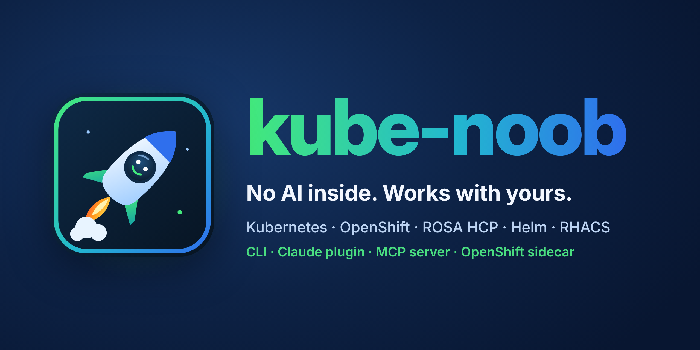

<p align="center">
  
</p>

# kube-noob

<!-- mcp-name: io.github.aashishmahajan/kube-noob -->

[](https://github.com/aashishmahajan/kube-noob/actions/workflows/ci.yml)
[](https://securityscorecards.dev/viewer/?uri=github.com/aashishmahajan/kube-noob)
[](https://pypi.org/project/kube-noob/)
[](https://github.com/aashishmahajan/kube-noob/blob/main/LICENSE)

**No AI inside. Works with yours.** kube-noob is a Kubernetes, OpenShift, ROSA HCP, Helm and RHACS/StackRox expert
in a box: audit rules, read-only-first playbooks, cited docs and graded exercises. Claude, OpenShift Lightspeed or any
MCP client calls it as tools; the CLI runs it with no AI at all. No network calls unless enabled.
Browse the rules, the demos and the recordings at **[kube-noob.com](https://kube-noob.com)**.

Two questions it answers that other tools do not, offline, from files you already have:

```bash
kube-noob policy reach --from web/frontend --to shop/payments --port 9090 -f examples/netpol-admin-tiers.yaml
kube-noob policy explain -f examples/denial-multi.txt
```

**Which policy governs this traffic?** `AdminNetworkPolicy` → `NetworkPolicy` → `BaselineAdminNetworkPolicy`, in
cluster order, naming the tier, policy and rule that decided. A checker reading NetworkPolicy alone gives a
**wrong** answer wherever a platform team set cluster-wide guardrails, not a narrower one.
**Which system denied this pod?** One pass across Pod Security, SCC, Kyverno, Gatekeeper, VAP and RHACS, with the
smallest fix. `reach` exits 1 when denied; both say what they could not determine.

Also: 93 rules with strict schemas and 9 red-team scenarios; 67 offline playbooks, read-only steps first;
must-gathers triaged into a case draft that says what could not be read; OpenShift bugs with fix versions; hardened
manifests and admission policies; 5 tracks, 16 lessons. `kube-noob gate` puts any of it in CI with SARIF and one
exception list, and a design request runs the 7-step protocol (Clarify, Validate, Research, Audit, Calibrate,
Generate, Red Team). Answers cite local knowledge as `[kn:<doc>#<n>]`. All of it: [use-cases.md](docs/use-cases.md).

## Who does the thinking

| You use | Who answers | What leaves your machine |
|---|---|---|
| The Claude plugin, or any MCP client | That client's model, calling kube-noob's tools | What you send that client; kube-noob sends nothing |
| The CLI | kube-noob's rules, no model | Nothing |
| `kube-noob ask` (optional) | A model you configure | Your question, to that model only |

## Quick start

```bash
brew tap aashishmahajan/kube-noob https://github.com/aashishmahajan/kube-noob
brew trust --formula aashishmahajan/kube-noob/kube-noob
brew install kube-noob
kube-noob demo --list
kube-noob audit -f your-manifests/ --platform openshift --version 4.22
kube-noob insight 'paste anything'
kube-noob doctor
```

No Homebrew: `uv tool install kube-noob` (Python 3.11.4+); [install help](https://github.com/aashishmahajan/kube-noob/blob/main/docs/install.md).

## Use with Claude or any MCP client

Claude plugin, in Claude Code (needs [uv](https://docs.astral.sh/uv/)):

```
/plugin marketplace add aashishmahajan/kube-noob
/plugin install kube-noob@kube-noob
```

Desktop app, claude.ai chat and the Agent Skill: [install.md](https://github.com/aashishmahajan/kube-noob/blob/main/docs/install.md). Any MCP client:

```json
{"mcpServers": {"kube-noob": {"command": "uvx", "args": ["--from", "kube-noob==0.8.0", "kube-noob", "mcp"]}}}
```

## Run on OpenShift

As a token-protected service, loopback-only sidecar or Lightspeed tool:
[docs/openshift.md](https://github.com/aashishmahajan/kube-noob/blob/main/docs/openshift.md). The chart ships
NetworkPolicies, written for `restricted-v2`.

## Safe by default

Off until you turn it on: web lookups, live cluster access (read-only, never Secrets), and any model at all. An
admin `offline: true` lock overrides every one of them and nothing later in the config chain can lift it. Config
never comes from the current directory. `kube-noob doctor` shows what the process can reach and exits 1 if the
configuration contradicts the lock; every key is in [kube-noob.example.yaml](https://github.com/aashishmahajan/kube-noob/blob/main/kube-noob.example.yaml), and the
generated [safety contract](https://github.com/aashishmahajan/kube-noob/blob/main/docs/safety-contract.md) lists what each capability tier can do.

## Docs

Everything is at **[kube-noob.com](https://kube-noob.com)**, and in [docs/](https://github.com/aashishmahajan/kube-noob/blob/main/docs/): [use cases](https://github.com/aashishmahajan/kube-noob/blob/main/docs/use-cases.md),
[architecture](https://github.com/aashishmahajan/kube-noob/blob/main/docs/architecture.md), [accuracy](https://github.com/aashishmahajan/kube-noob/blob/main/docs/evals/supported-technologies.md),
[guidance](https://github.com/aashishmahajan/kube-noob/blob/main/docs/guidance.md), [learning](https://github.com/aashishmahajan/kube-noob/blob/main/docs/learning.md), [privacy](https://github.com/aashishmahajan/kube-noob/blob/main/PRIVACY.md), [security](https://github.com/aashishmahajan/kube-noob/blob/main/SECURITY.md),
[contributing](https://github.com/aashishmahajan/kube-noob/blob/main/CONTRIBUTING.md), [limits](https://github.com/aashishmahajan/kube-noob/blob/main/docs/limits.md), [roadmap](https://github.com/aashishmahajan/kube-noob/blob/main/docs/roadmap.md), [maintenance](https://github.com/aashishmahajan/kube-noob/blob/main/MAINTENANCE.md), [governance](https://github.com/aashishmahajan/kube-noob/blob/main/GOVERNANCE.md).


## Credits

Notices: [THIRD_PARTY_NOTICES.md](https://github.com/aashishmahajan/kube-noob/blob/main/THIRD_PARTY_NOTICES.md). Kubernetes, Helm, OpenShift, ROSA, RHACS, StackRox,
OpenShift Lightspeed, Claude, Anthropic, GitHub and AWS are trademarks of their respective owners; kube-noob is
independent and not endorsed by them. License: [Apache-2.0](https://github.com/aashishmahajan/kube-noob/blob/main/LICENSE).
