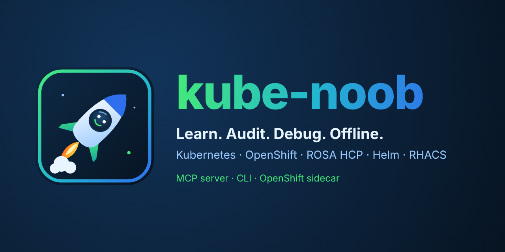

<p align="center">
  
</p>

<p align="center">
  <a href="https://github.com/aashishmahajan/kube-noob/actions/workflows/ci.yml"></a>
  <a href="https://securityscorecards.dev/viewer/?uri=github.com/aashishmahajan/kube-noob"></a>
  <a href="LICENSE"></a>
</p>

# kube-noob

**Offline-first learning, manifest-audit and debugging agent for Kubernetes, Helm, OpenShift, ROSA (Classic and
Hosted Control Planes) and RHACS / StackRox.** Use it as an **MCP server** (Claude Desktop/Code, Cursor, VS Code, any
MCP client), a **CLI**, a **Claude plugin**, or a **sidecar / service on OpenShift**.

- **7-step engineering protocol** on every request: Clarify, Validate, Research, Audit, Calibrate, Generate, Red Team.
- **Deterministic engine**: 60 audit rules (security, network exposure, storage access modes, reliability, platform
  correctness, removed APIs), strict schema validation (Kubernetes 1.35 + Route, SCC, EgressFirewall, Gateway API,
  StackRox CRDs), 9 red-team scenarios, safe auto-fixes, mapping to RHACS default policy names.
- **Generator**: hardened manifests or Helm charts for `kubernetes`, `openshift`, `rosa-classic`, `rosa-hcp`; every
  output is re-audited before it is returned.
- **Debugging**: 33 offline playbooks (CrashLoopBackOff, OOMKilled, SCC/PSA rejections, PVC pending, Multi-Attach,
  Route 503, RBAC, webhook/RHACS denials, Helm locks, ROSA HCP machine pools...) plus opt-in, **read-only** live
  cluster evidence collection (Secrets are never read; sensitive values are redacted).
- **Learning**: 5 tracks, 16 lessons, graded exercises and quizzes with credits - all graded offline.
- **Local knowledge, credited**: 28 curated, fact-checked docs built in, plus a provenance-tracked corpus builder
  (Kubernetes/OpenShift/ROSA/Helm docs, Terraform ROSA HCP modules, StackRox policies, release history and public RHACS
  Jira issues). Every answer can cite `[kn:<doc>#<n>]` chunks with source URL and license.
- **Training-ready**: deterministic reward (the "enforcer and credit system") with a TRL `GRPOTrainer` adapter, a
  held-out benchmark, and license-aware SFT/GRPO dataset export.
- **Web is off by default** (`webEnabled: false`). Turn it on explicitly and only allowlisted documentation domains are
  reachable.

## Quick start

```bash
pip install kube-noob            # or: uvx kube-noob --help
kube-noob audit -f k8s/ --platform openshift --version 4.22
kube-noob protocol "deploy orders-api on ROSA HCP with shared storage" --blueprint blueprint.yaml
kube-noob diagnose -f events.txt
kube-noob learn tracks
```

`blueprint.yaml`:
```yaml
name: orders-api
namespace: shop
image: quay.io/acme/orders@sha256:...
platform: rosa-hcp
replicas: 3
storage: {size: 20Gi, accessMode: ReadWriteMany}     # -> efs-sc, never gp3-csi
exposure: {type: route, host: orders.apps.example.com}
egressDnsNames: [api.stripe.com]                     # -> EgressFirewall named 'default', Deny-all last
```

### As an MCP server

Claude Code / Claude Desktop (`claude_desktop_config.json` or `.mcp.json`):
```json
{"mcpServers": {"kube-noob": {"command": "uvx", "args": ["kube-noob", "mcp"]}}}
```
Or install the plugin (skills + server): `/plugin marketplace add aashishmahajan/kube-noob` then
`/plugin install kube-noob@kube-noob`.

Tools (all prefixed `kubenoob_`): `run_protocol`, `validate_manifests`, `audit_manifests`, `red_team`,
`fix_manifests`, `clarify_requirements`, `generate_manifests`, `generate_helm_chart`, `search_knowledge`,
`get_knowledge`, `api_history`, `explain_rule`, `list_rules`, `diagnose`, `learn_*`, `grade_answer`, `config_status`,
and - only when enabled - `cluster_get`, `cluster_debug_workload`, `cluster_version`, `web_fetch`.
Prompts: `master_controller`, `debug_session`, `tutor`. Resources: `kubenoob://knowledge/{doc}`, `kubenoob://rules`,
`kubenoob://curriculum`.

### On OpenShift / Kubernetes

Service (authenticated streamable HTTP, NetworkPolicies, restricted-v2 compatible):
```bash
oc create secret generic kube-noob-token --from-literal=token="$(openssl rand -hex 32)" -n kube-noob
helm install kube-noob deploy/helm/kube-noob -n kube-noob --set auth.existingSecret=kube-noob-token
```
Sidecar (loopback only, no token needed): see [`deploy/sidecar/app-with-kube-noob-sidecar.yaml`](deploy/sidecar/app-with-kube-noob-sidecar.yaml).

Read-only live cluster tools: `--set config.clusterEnabled=true --set "networkPolicy.egress.apiServerCIDRs={<api ip>/32}"`
(creates a read-only ClusterRole without Secrets; `rbac.scope=namespace` for a namespaced Role).

## Configuration

`kube-noob.yaml` (lookup: `$KUBE_NOOB_CONFIG`, `./kube-noob.yaml`, `~/.config/kube-noob/config.yaml`,
`/etc/kube-noob/config.yaml`). See [`kube-noob.example.yaml`](kube-noob.example.yaml).

| Key | Default | Env override |
|---|---|---|
| `webEnabled` | `false` | `KUBE_NOOB_WEB_ENABLED` |
| `web.allowedDomains` | kubernetes.io, helm.sh, docs.redhat.com, ... | |
| `cluster.enabled` / `cluster.backend` | `false` / `auto` (in-cluster, oc, kubectl) | `KUBE_NOOB_CLUSTER_ENABLED`, `KUBE_NOOB_CLUSTER_BACKEND` |
| `llm.provider` / `llm.model` | `anthropic` / `claude-fable-5-1` | `KUBE_NOOB_LLM_PROVIDER`, `KUBE_NOOB_LLM_MODEL` |
| `llm.baseUrl` | - (set for `openai-compatible`: vLLM, Ollama, your fine-tuned model) | `KUBE_NOOB_LLM_BASE_URL` |
| `judge.provider` | `none` (LLM judge is eval-only) | |
| `defaultPlatform` | `kubernetes` | `KUBE_NOOB_DEFAULT_PLATFORM` |
| `dataDir` | `~/.local/share/kube-noob` | `KUBE_NOOB_DATA_DIR` |
| HTTP auth token | - | `KUBE_NOOB_HTTP_TOKEN` |

The standalone agent (`kube-noob ask "..."`) uses the Anthropic API (`ANTHROPIC_API_KEY`) with server-side fallbacks if
the requested model's classifier declines, or any OpenAI-compatible endpoint. The MCP server itself never calls an LLM.

## Corpus, history and RHACS Jira insights

```bash
kube-noob corpus build --online              # public Git docs with license + commit provenance
kube-noob corpus history --online            # release timelines from Git tags
kube-noob corpus jira --online --project ROX --min-version 4.10 --target 1200   # jittered, rate-limited pull
kube-noob corpus verify && kube-noob corpus stats
```
Licenses are recorded per record. Non-commercial, copyleft or unlicensed sources (and Jira issue text) are marked
`redistributable: false`: usable for local retrieval and private evaluation, excluded from exports unless you pass
`--include-restricted`. The `corpus-refresh` GitHub workflow runs all of this in the cloud weekly.

## Training: enforcer and credit system

```bash
kube-noob train export --out dataset/        # sft.jsonl (chat format) + grpo_prompts.jsonl
kube-noob train grade --task bench-qa-rwx-gp3 -f answer.md
kube-noob train bench --out report.json      # runs the configured model through the held-out benchmark
```
Reward = 0.70 task correctness (audit engine / QA rules) + 0.20 source-attribution credit (valid `[kn:...]` citations)
+ 0.10 format, minus penalties for fabricated citations and non-answers. Plug into TRL:
`GRPOTrainer(reward_funcs=[kube_noob.evals.reward.trl_reward], ...)` with a `task_id` dataset column.
Exports contain no LLM-generated labels. If you add Claude-generated data yourself, check Anthropic's terms first.

## Security

Supply chain: hash-pinned dependencies, SHA-pinned GitHub Actions, CodeQL, OpenSSF Scorecard, Dependabot, PyPI Trusted
Publishing (no tokens), SLSA build provenance attestations, SBOMs and keyless Sigstore signatures on container images.
Runtime: no network unless enabled, allowlisted domains (redirects included), read-only cluster access without
Secrets, YAML bomb limits, constant-time bearer auth, DNS-rebinding protection. See [SECURITY.md](SECURITY.md).

## Credits

kube-noob learns from and credits the Kubernetes documentation (CC BY 4.0), OpenShift documentation (Apache-2.0),
Red Hat Cloud Experts (Apache-2.0), HyperShift, rosa CLI and terraform-redhat modules (Apache-2.0), Helm docs (MIT),
StackRox (Apache-2.0), kubernetes-json-schema (Apache-2.0), datree CRDs-catalog (MIT), CKAD-exercises (MIT), Kubernetes
The Hard Way (Apache-2.0) and others - see [THIRD_PARTY_NOTICES.md](THIRD_PARTY_NOTICES.md). Kubernetes, OpenShift,
Helm, ROSA, RHACS and StackRox are trademarks of their owners; kube-noob is independent and not endorsed by them.

Licensed under [Apache-2.0](LICENSE).
