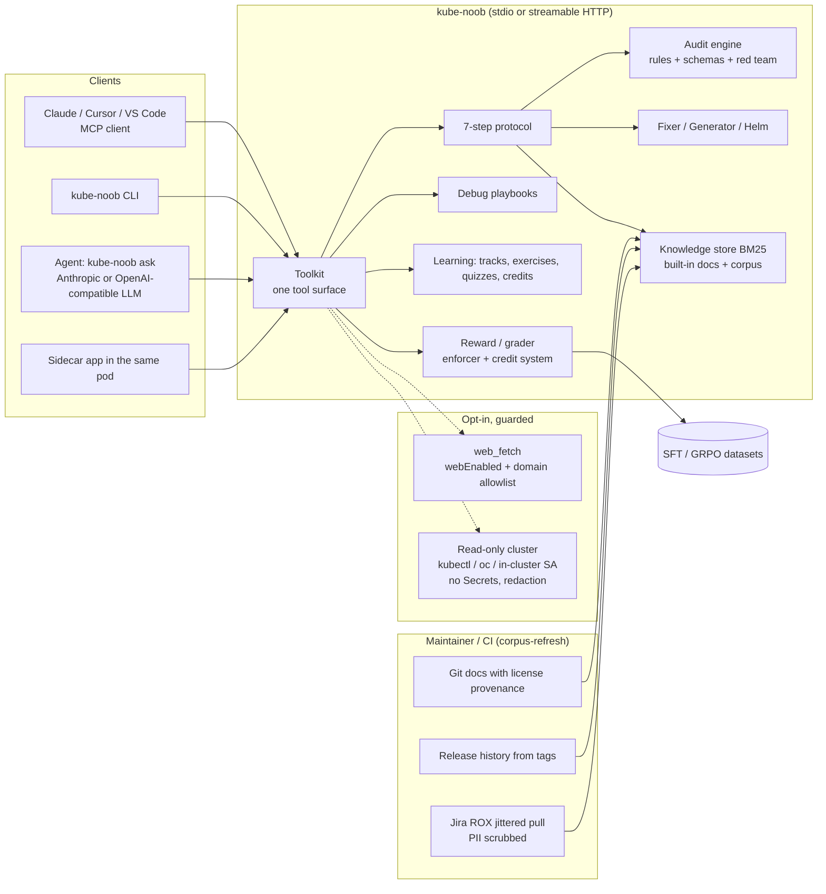

# Architecture

## Request flow (run_protocol)

1. **Clarify** - platform/version inference (blueprint > explicit > request text > manifest API groups), blocking
   questions vs stated assumptions.
2. **Validate** - strict JSON schema (Kubernetes 1.35 + CRDs), apiVersion/kind catalog, removed APIs per target version,
   selector/port wiring.
3. **Research** - BM25 over local knowledge; results carry chunk ids, source URLs and licenses.
4. **Audit** - security, RBAC, network exposure, storage access modes vs provisioner capabilities.
5. **Calibrate** - probes, resources, replicas, PDBs, topology spread, HPA prerequisites.
6. **Generate** - deterministic generator (blueprints) or mechanical fixer (existing YAML) with a change log.
7. **Red Team** - nine adversarial scenarios evaluated on the final output; remaining HIGH/CRITICAL findings mark the
   result `blocked`.

## Trust boundaries

- MCP clients and model output are untrusted input: every tool validates with Pydantic, YAML is size/alias bounded.
- The HTTP transport authenticates with a bearer token (constant time) unless bound to loopback (sidecar).
- Outbound HTTP only through `kube_noob.net`: web purpose requires `webEnabled` and allowlisted HTTPS hosts on every
  hop; LLM and in-cluster API clients are separate, explicit purposes.
- Cluster access is read-only, allowlisted per resource, never Secrets, and redacts values before they reach a model.
