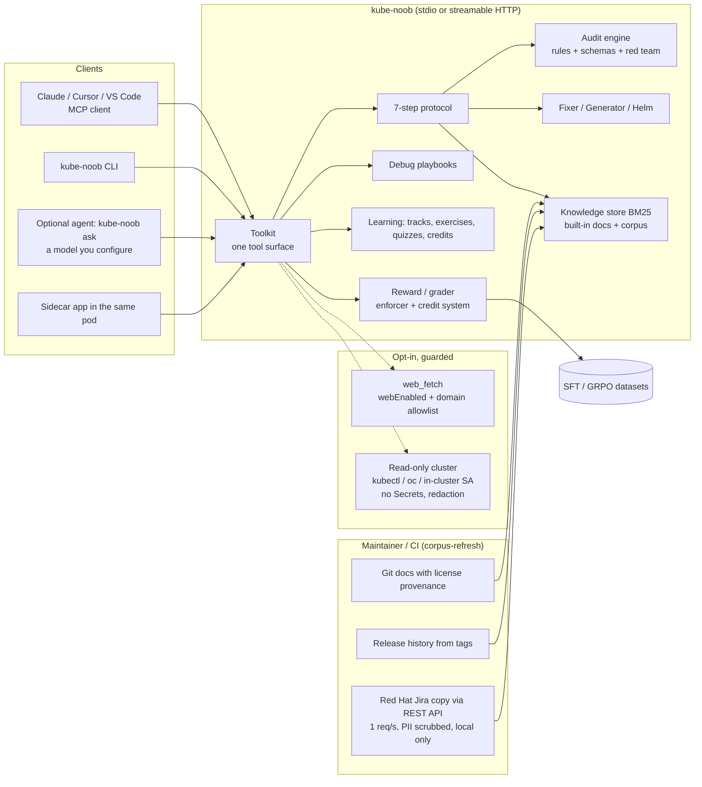

# Architecture

kube-noob has no model inside. The server, the CLI and the plugin run deterministic code: rules, schemas, playbooks,
a BM25 index and graders. A model appears only on the client side (Claude, Lightspeed, any MCP client) or in the
optional `kube-noob ask` agent, which calls the same toolkit.

## Request flow (run_protocol)

1. **Clarify** - platform/version inference (blueprint > explicit > request text > manifest API groups), blocking
   questions vs stated assumptions.
2. **Validate** - strict JSON schema (Kubernetes 1.35 + CRDs), apiVersion/kind catalog, removed APIs per target version,
   selector/port wiring.
3. **Research** - BM25 over local knowledge; results carry chunk ids, source URLs and licenses.
4. **Audit** - security, RBAC, network exposure, storage access modes vs provisioner capabilities.
5. **Calibrate** - probes, resources, replicas, PDBs, topology spread, HPA prerequisites.
6. **Generate** - deterministic generator (blueprints) or mechanical fixer (existing YAML) with a change log.
7. **Red Team** - nine adversarial scenarios evaluated on the final output; remaining HIGH/CRITICAL findings mark the
   result `blocked`.

## Trust boundaries

- MCP clients and model output are untrusted input: every tool validates with Pydantic, YAML is size/alias bounded.
  Text that came from outside is untrusted on the way out too: `kube_noob.sanitize` cleans every MCP result (invisible
  characters, role and tool-call markers, instruction phrases, exfiltrating Markdown) and flags it `untrusted`.
  Pasted payloads are data too: an Alertmanager payload is read as JSON only (2 MB, 500 alerts, 64 labels, 2,000
  characters per value, control characters dropped), and only an OpenShift release label sets the version.
- The HTTP transport authenticates with a bearer token (constant time) unless bound to loopback (sidecar).
- Outbound HTTP only through `kube_noob.net`: web purpose requires `webEnabled` and allowlisted HTTPS hosts on every
  hop, GET only; `web_fetch` refuses non-text content types before reading the body. LLM and in-cluster API clients
  are separate, explicit purposes.
- The admin lock (`offline: true`) is applied at config load and only tightens: it disables web, refuses corpus
  downloads and allows only loopback or `*.svc` model endpoints. `kube-noob doctor` reports the result.
- Cluster access is read-only, allowlisted per resource, never Secrets, and redacts values before they reach a model.
  Diagnoses list read-only steps first; commands that execute or change state are labelled as needing approval.
- Anything beyond reading is a capability tier (`kube_noob.tiers`: probe, dry-run, external writes, gate forwarding),
  off by default. Code that changes something is a `Writer` that cannot be built while its tier is off, and each
  action needs a person's `Approval` for that action, unexpired and used once. The read-only backends have no write
  method; tier RBAC renders only when the tier is on.
- A memory repository (`kube_noob.memory`) is the team's own Git content: kube-noob reads it locally, writes only on
  `memory init`, `add`, `outcome` and `migrate-learning` (new files created exclusively, rewrites atomic), never runs
  git, and never bundles, publishes or exports it. Entries are untrusted input until `memory validate` passes:
  bounded YAML, content rules, and the verifier on every fix (validate, audit and red team on patches; privileged
  SCC, cluster-admin, hostPath and wildcard RBAC grants fail without a recorded risk acceptance). In the chart the
  repository is mounted read-only; the git source is cloned by an init container (no credentials in the URL, a
  deploy key from a Secret, strict host keys), with egress only to the git host's CIDRs and, under the offline
  lock, only from an in-cluster host.
- The Red Hat Jira copy is local data that is not redistributable. Each sync appends status, resolution and
  fix-version changes to `jira/changes.jsonl` (owner-only, atomic, capped); reconciliation reads it and the ticket
  index offline. A snapshot (`corpus jira-snapshot`) is owner-only; `corpus import` validates its file names,
  sizes, checksums and that it comes from the same Jira before copying anything. `serve` imports a seed from
  `<dataDir>/seed/` only when there is no copy, and the chart mounts the seed read-only (an init container copies it
  from a pinned image, or a read-only claim). The scheduled main copy leaves the runner only encrypted.
- `<dataDir>/learning.json` holds user-confirmed summaries, the user's profile and id counters only. Notes are indexed
  as `origin: local`, are never redistributable and never exported as training data.
